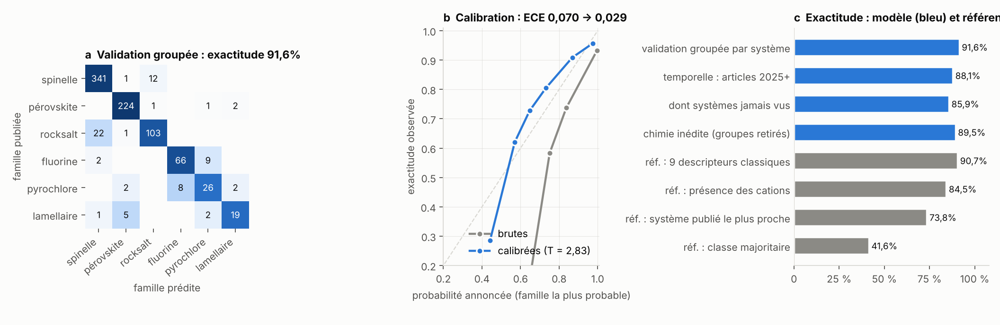

# heo-platform — conception assistée d'oxydes à haute entropie

[](https://github.com/badi-project/heo-platform/actions/workflows/ci.yml)

Chaîne complète allant de la récolte de littérature à une application de design
autonome : extraction d'une base de données d'oxydes à haute entropie (HEO) à partir
de 2 189 notices bibliographiques, stœchiométrie relue dans les formules écrites,
134 descripteurs compositionnels, classifieur de famille structurale validé par groupes
chimiques et dans le temps, modèle géométrique de paramètre de maille, simulation de
diffractogramme de poudre, et criblage de 739 222 compositions.

## Résultats principaux (v1.1)

| Sortie | Statut | Performance mesurée |
|---|---|---|
| Famille structurale (6 classes) | opérationnel | exactitude 91,6 %, F1 macro 0,848 (validation groupée par système) |
| — sur des systèmes publiés après l'entraînement | opérationnel | 85,9 % sur 192 systèmes inédits de 2025-2027 (présence des cations seule : 70,8 %) |
| — sur des familles chimiques entières retirées | opérationnel | 89,5 % (système publié le plus proche : 54,0 %) |
| Pérovskite ou non | opérationnel | 98,5 % (règle de Goldschmidt optimisée sur la base : 94,6 %) |
| Calibration des probabilités | opérationnel | erreur 0,070 → 0,019 (température ajustée sur d'autres systèmes) |
| Paramètre de maille des spinelles (CHGNet) | opérationnel, ± 0,5 % | 0,35 % sur 13 spinelles HEO de maille mesurée ; échantillon interne +0,24 % |
| Paramètre de maille, autres familles (rayons de Shannon par valence et coordinence) | opérationnel, ± 0,2 à 1,2 % selon la famille | 0,53 % sur 63 HEO mesurés des cinq familles (modèle précédent : 1,99 %) ; rocksalt 1,18 %, **critère de 1 % non atteint** |
| Rocksalt ou spinelle, cation inconnu du modèle | complément, hors domaine | 78,6 % → 81,8 % avec l'enthalpie d'oxydation calculée ; aucun gain dans le domaine |
| Monophasage des rocksalt (Sivak et al.) | démonstration, 8 systèmes | 7 / 8 en un-contre-tous |
| Énergie de lacune d'oxygène | descripteur validé, activité non prédite | suit la réductibilité mesurée de 9 oxydes binaires (corrélation de rang 0,93) ; §12 du rapport |
| Choix des prochaines synthèses | opérationnel | 27 % de synthèses en moins que le hasard (banc rétrospectif, critère 25 %) ; 4 propositions à la frontière rocksalt / spinelle |
| Diffractogramme simulé | opérationnel | positions et intensités validées contre `pymatgen` |
| Domaine d'applicabilité | opérationnel | seuil au 95ᵉ centile des distances d'entraînement |
| Monophasé / multiphasé | peu fiable | 406 positifs contre 49 négatifs (biais de publication) |
| Propriétés catalytiques | non implémenté, délibérément | les surpotentiels publiés ne sont pas apprenables (corrélation intraclasse 0,00) — §6 et §12 du rapport |

La confusion dominante reste **rocksalt ↔ spinelle** (23 rocksalt prédits spinelle,
13 l'inverse) : les mêmes cations 3d donnent l'une ou l'autre structure selon la
température et la pression d'oxygène, information que la composition seule ne porte
pas.

Base curée : **1 074 échantillons**, 869 publications identifiées par DOI, 539 systèmes
cationiques distincts, 54 cations. Criblage : **274 712** compositions dans le domaine
d'applicabilité, dont **274 514** absentes de la base.



### Ce que la v1.1 a corrigé

La v1.0 calculait tous les descripteurs sur un mélange équimolaire de l'ensemble de
cations choisi par le modèle de langue d'extraction. Cet ensemble perdait régulièrement
un site cristallographique entier — (Na₀.₂Bi₀.₂Ba₀.₂Sr₀.₂Ca₀.₂)TiO₃ était stocké sans Ti,
38 pérovskites sur 240 n'avaient aucun cation de site B — et certaines entrées « titre
seul » portaient des cations que le titre ne nomme pas.

La v1.1 relit la stœchiométrie dans la formule écrite (`src/formula.py`, miroir
JavaScript vérifié sur les 1 086 formules de la base et des tests) :

- 142 ensembles de cations corrigés, dont 121 où un site oublié est restitué ;
- 59 entrées écartées, chacune avec sa raison (`QC/database_cleaning.txt`) : cations
  non attestés dans le texte source, stœchiométrie illisible pour une structure à
  plusieurs sites, moins de cinq cations dans la formule lisible, rejets manuels ;
- deux audits manuels de la stœchiométrie relue (`QC/audit_stoechiometrie.csv`,
  n = 50 ; `QC/audit_stoechiometrie_2.csv`, n = 60 dont 40 parmi les formules les plus
  difficiles) : 0 erreur résiduelle significative, 3 lectures ambiguës telles
  qu'écrites ;
- la chaîne d'entraînement est dans le dépôt (`tools/train_model.py`) et régénère le
  modèle publié au bit près ;
- les résumés d'éditeurs ont été retirés de `data/heo_corpus.jsonl` (seules leurs
  longueurs restent).

**La stœchiométrie écrite ne « souffle » pas la réponse** : un modèle qui ne voit que
les fractions triées, sans aucune identité chimique, plafonne à 25,6 % ; restreint aux
458 compositions équimolaires (aucun indice de stœchiométrie), le modèle complet garde
91,5 % d'exactitude.

### Couche physique et boucle de décision (étapes 1 à 3)

Le classifieur dit ce que la littérature *rapporte*. Trois prolongements ajoutent ce
qu'elle ne peut pas dire, chacun jugé sur des mesures avec un critère écrit avant le
calcul (rapport, §11 à §13) :

1. **Thermodynamique calculée** (`thermo/`, potentiel interatomique universel CHGNet) :
   enthalpie d'oxydation rocksalt → spinelle sur 80 systèmes de la base (AUC 0,95 entre
   systèmes rapportés rocksalt et spinelle), maille des spinelles calibrée sur 17
   binaires, descripteur de monophasage de Sivak et al. Le critère initial — améliorer
   le classifieur dans son domaine — **n'est pas atteint** : le calcul ne sert qu'hors du
   domaine, où il évite par exemple de tomber au hasard quand Zn est inconnu du modèle.
2. **Réductibilité** : la variance des surpotentiels OER publiés est mesurée (la
   composition en explique 0 % [0-16 %]) ; à la place, l'énergie de formation d'une lacune d'oxygène est calculée : elle suit la réductibilité mesurée de 9 oxydes binaires (corrélation de rang 0,93, critère 0,70) et classe les substitutions de (CoCrFeMnNi)₃O₄ dans l'ordre attendu de leur chimie redox. Elle reste à confronter à des mesures OER à protocole constant — une série de substitutions est proposée pour cela.
3. **Apprentissage actif** (`tools/active_learning.py`) : rejouée sur la base, la sélection des synthèses les plus informatives atteint la même exactitude avec 27 % de synthèses en moins que le hasard — critère atteint de justesse. Quatre compositions inédites sont proposées, à la frontière rocksalt / spinelle, chacune avec la prédiction du classifieur et celle du calcul (`data/next_experiments.csv`). Les résultats
   de laboratoire, échecs compris, entrent par `data/lab_results.csv`.

La page affiche ces résultats dans une carte « Thermodynamique calculée ».

## Application

`app/heo_designer.html` est un fichier unique sans dépendance réseau : il embarque la
base, le modèle exporté, le calcul des descripteurs, la lecture des formules et la
simulation DRX. Ouvrir par double-clic, ou cloner puis servir le dossier `app/` :

```bash
git clone https://github.com/badi-project/heo-platform.git
cd heo-platform/app && python -m http.server 8000   # puis http://localhost:8000/heo_designer.html
```

On y saisit une formule comme dans un article — `La(CrMnFeCoNi)O3`,
`(Na0.2Bi0.2Ba0.2Sr0.2Ca0.2)TiO3`, `(FeCoNiCrMn)3O4` — ou l'on choisit les cations.

Le portage JavaScript des descripteurs, du modèle et de la lecture des formules est
vérifié contre Python à chaque commit : écart maximal de probabilité 1,1 × 10⁻¹⁶, 0 écart
sur les 1 086 formules (`QC/parity_check.txt`).

Depuis l'étape « outil de travail » (voir le journal des modifications), la page fait aussi :

- **un lot de formules** : coller une liste ou charger un CSV, obtenir le tableau des
  prédictions et l'exporter ;
- **des exports** : la prédiction (.csv), le profil de diffraction simulé (.xy), la liste
  des réflexions avec leurs distances interréticulaires ;
- **la densité théorique** (rayons X) de la phase prédite ;
- **la confrontation à un diffractogramme mesuré** : le fichier (deux colonnes 2θ,
  intensité, ou .xrdml) est indexé sur chacun des cinq prototypes cubiques, la maille est
  affinée par moindres carrés, les pics qu'aucune réflexion n'explique sont signalés, et
  une ligne prête pour `data/lab_results.csv` peut être exportée. Ce n'est pas un
  affinement de Rietveld.

## Prédire sans navigateur

`src/predict.py` reproduit en Python, avec la bibliothèque standard, tout ce que calcule
la page ; `tools/heo_predict.py` en est la ligne de commande.

```bash
python tools/heo_predict.py "(FeCoNiCrMn)3O4" --peaks              # rapport lisible + réflexions
python tools/heo_predict.py "La(CrMnFeCoNi)O3" --json              # sortie complète
python tools/heo_predict.py --csv formules.csv --out predictions.csv   # tout un fichier
python tools/heo_predict.py "(FeCoNiCrMn)3O4" --xy motif.xy         # profil simulé
python tools/heo_predict.py "(FeCoNiCrMn)3O4" --measured scan.xy    # indexer une mesure
```

```python
import sys; sys.path.insert(0, "src")
from predict import Predictor
r = Predictor().predict("(FeCoNiCrMn)3O4")
r["family"], r["probability"], r["in_domain"], r["lattice"]["a"], r["lattice"]["density_g_cm3"]
```

Les deux moteurs sont comparés à chaque commit sur les 1 272 compositions de la base et
du jeu de contrôle, sur les lignes de tableau des 1 086 formules (caractère pour
caractère) et sur l'indexation de sept motifs mesurés synthétiques (`QC/parity_check.txt`).

| Contrôle | Résultat | Rapport |
|---|---|---|
| Densité avec la maille mesurée de 4 oxydes de référence | écart maximal 0,71 % (critère 1 %) | `QC/density_validation.txt` |
| Densité avec la maille prédite, spinelles (CHGNet), 13 HEO mesurés | écart moyen 1,1 % (critère 2 %) | idem |
| Densité avec la maille prédite, modèle géométrique, 50 HEO mesurés | écart moyen 1,6 % (critère 6 %), maximum 12,6 % (rocksalt au Sr) | idem |
| Maille prédite, 48 oxydes simples de référence | écart moyen 0,23 à 0,44 % selon la famille (porte : 1 %) | `QC/lattice_validation.txt` |
| Maille prédite, 63 HEO de maille mesurée, protocole écrit avant le calcul | 0,53 % ; pyrochlore 0,23, fluorine 0,27 (validation non aveugle), pérovskite 0,48, spinelle 0,70, rocksalt 1,18 (**non atteint**) | idem |
| Correction apprise de la maille (biais, ridge, gradient boosting), hors échantillon par groupe de sources | 0,53 → 0,49 % : gain de 0,04 point, **sous le seuil de 0,1 point ; non intégrée** | `QC/lattice_correction.txt` |
| Dispersion entre laboratoires sur une même composition | 0,02 à 0,14 % en moyenne ; jusqu'à 1,5 % d'étendue pour (CoCrFeMnNi)₃O₄ | `QC/lattice_dataset.txt` |
| Maille affinée sur motifs synthétiques propres (jeu vierge, 6 cas) | écart maximal 0,017 % (critère 0,05 %) | `QC/xrd_fit_validation.txt` |
| Idem, motifs bruités | écart maximal 0,14 % (critère 0,25 %) | idem |
| Raies d'une phase étrangère signalées | 4 / 4, aucune fausse alerte | idem |

L'onglet « Candidats criblés » montre les **3 786 candidats exportés** — un
sous-ensemble plafonné à 700 par prototype. Le criblage intégral est dans
`data/screening_all.csv.gz`, pas dans l'application.

## Organisation du dépôt

```
app/        application autonome (HTML + JS + modèle exporté)
src/        features.py — les 134 descripteurs ; formula.py — lecture des formules ;
            predict.py — prédiction complète ; xrdfit.py — indexation d'une mesure ;
            radii.py — rayons de Shannon ; lattice.py — modèle de maille
data/       base brute v1.0 et base curée, descripteurs, candidats, criblage, corpus
data/reference/  tables élémentaires, prototypes DRX, rayons de Shannon, règles du modèle
            de maille, mailles mesurées sourcées et protocole de validation
figures/    fig1 à fig6
docs/       rapport méthodologique et note de faisabilité
thermo/     calculs par potentiel interatomique appris (CHGNet) et leurs analyses
data/thermo/  résultats de ces calculs et références thermochimiques sourcées
tools/      chaîne de production (voir ci-dessous), apprentissage actif et contrôles
tests/      suite pytest exécutée en intégration continue
QC/         rapports régénérés : nettoyage, entraînement, criblage, parité, audits
```

| Fichier | Contenu |
|---|---|
| `data/heo_database_raw.csv` | base v1.0 telle que publiée, jamais modifiée (entrée du nettoyage) |
| `data/heo_database.csv` | 1 074 échantillons curés, fractions relues, DOI et phrase source |
| `data/heo_features.csv` | matrice des 134 descripteurs |
| `data/heo_candidats.csv` | 3 786 candidats non publiés, avec voisin publié le plus proche |
| `data/screening_all.csv.gz` | les 739 222 compositions criblées |
| `data/heo_corpus.jsonl` | 2 189 notices récoltées (EuropePMC, Crossref, arXiv), sans résumé |
| `data/heo_extracted.jsonl` | sortie brute d'extraction, avant curation |
| `app/heo_model.json` | modèle exporté, métriques, domaine d'applicabilité, jeu de contrôle |
| `data/reference/shannon_radii.json` | rayons de Shannon (1976) par valence, coordinence et spin, 58 cations |
| `data/reference/lattice_measured.csv` | 132 mailles mesurées, 32 sources, une source par ligne |
| `data/reference/lattice_protocol.md` | protocole de validation du modèle de maille, écrit avant le calcul, amendements datés |
| `data/reference/lattice_rules.json` | valences, sites et relations du modèle de maille, lus par Python et par la page |

## Chaîne de production

```bash
pip install -r requirements-train.txt   # numpy, scikit-learn, matplotlib (versions figées)
python tools/clean_database.py          # base brute -> base curée (QC/database_cleaning.txt)
python tools/train_model.py             # descripteurs, validations, export (QC/training_report.txt)
python tools/screen.py                  # criblage (QC/screening_report.txt)
python tools/make_figures.py            # figures 4 et 5
python tools/build_app.py               # données et textes de la page, puis ré-inlining du JS
python tools/lattice_dataset.py         # mailles mesurées : contrôle, dispersion (QC/lattice_dataset.txt)
python tools/validate_lattice.py        # modèle de maille (QC/lattice_validation.txt)
python tools/learn_lattice_correction.py  # correction apprise de la maille (QC/lattice_correction.txt)
python tools/validate_density.py        # densité théorique (QC/density_validation.txt)
python tools/validate_xrd_fit.py        # affinement de maille (QC/xrd_fit_validation.txt)
python tools/parity_check.py            # parité Python / JavaScript (nécessite node >= 20)
python -m pytest tests -q
```

Les calculs CHGNet (`pip install -r requirements-thermo.txt`, plusieurs heures sur deux
cœurs) et leur ordre d'exécution sont décrits dans [`thermo/README.md`](thermo/README.md) ;
leurs résultats sont versionnés dans `data/thermo/`, si bien que la chaîne ci-dessus et
les tests n'ont pas besoin de les relancer.

Chaque étape a un mode `--check` exécuté par la CI : la base, la page et les contrôles
publiés doivent être exactement la sortie de la chaîne.

## Méthode, en bref

- **Corpus** : EuropePMC (561), Crossref (1 527), arXiv (101), filtrage par expression
  exacte sur titre et résumé, déduplication par DOI.
- **Extraction** : modèle de langue sous schéma JSON imposé, phrase source conservée.
- **Curation** : stœchiométrie relue dans la formule écrite (groupes, fractions,
  variables, placeholders, composites), au moins cinq cations à ≥ 1 % de la somme
  cationique.
- **Modèle** : arbres de décision boostés par histogramme, 250 itérations, 15 feuilles,
  pondération équilibrée des classes. Trois validations : 20 plis groupés par système
  cationique ; temporelle (≤ 2024 → 2025-2027) ; chimie inédite (20 familles de systèmes
  retirées tour à tour). Probabilités calibrées par mise à l'échelle de température.

Le détail complet, les contrôles physiques et les pièges de portage sont dans
[`docs/RAPPORT_plateforme_HEO.md`](docs/RAPPORT_plateforme_HEO.md).

## Limites à lire avant usage

- La probabilité affichée est celle d'une **famille structurale**, jamais d'une
  performance catalytique ni d'un monophasage.
- 53 % des compositions énumérées dans le domaine sont prédites pérovskite :
  l'énumération combinatoire sur un vivier riche en terres rares et alcalino-terreux
  produit massivement des compositions à gros cations. La liste de candidats se lit par
  famille chimique, pas ligne à ligne.
- Une formule décrivant une série (`(M0.2La0.2…)CrO3 (M = Dy, Ho, Er)`) est lue sur sa
  première variante ; les variables x, y, z valent 0,1.
- Le modèle de maille est validé sur 63 oxydes à haute entropie de maille mesurée, mais
  inégalement : 9 pérovskites (dont 6 d'un même article), 10 pyrochlores (9 zirconates).
  Les titanates, stannates et hafnates pyrochlores, les pérovskites à site A alcalin et
  toute composition éloignée de ces séries restent peu ou pas vérifiés.
- **Rocksalt : critère de 1 % non atteint** (1,18 %). Les compositions contenant Sr²⁺ ou
  K⁺ ont la maille de la matrice sans ce cation : le modèle prédit une dilatation que la
  mesure ne montre pas (+4,6 % pour le strontium). La page le signale, sans corriger.
- **Fluorine : validation non aveugle.** La correction des lacunes d'oxygène a été ajoutée
  après la lecture des résidus (amendement A1 du protocole) ; sans elle, l'erreur est de
  1,40 %. Les fluorines au manganèse sont sous-estimées de 0,6 % (valence supposée).
- Les valences sont déduites de l'électroneutralité dans un ordre fixé, pas mesurées ;
  l'occupation des sites du spinelle suit une échelle de préférence, pas une mesure.
- Pour une même composition nominale, deux laboratoires trouvent des mailles différentes
  — jusqu'à 1,5 % pour (CoCrFeMnNi)₃O₄. Aucun modèle de composition seule ne descend
  sous cet écart.
- La densité théorique suppose le sous-réseau d'oxygène complet ; une fluorine riche en
  cations trivalents est plus légère (jusqu'à environ 4 %).
- L'indexation d'un diffractogramme mesuré n'est validée que sur des **motifs
  synthétiques** — le dépôt ne contient aucun fichier de diffraction réel. Elle ne lit
  que la position des pics, sur des prototypes cubiques, une phase à la fois.
- Les grandeurs calculées (`thermo/`) viennent d'un potentiel appris, pas de la DFT ;
  ses erreurs redox brutes atteignent 0,7 eV/O et ne sont corrigées que pour Co, Fe et
  Mn (rapport, §11.2).

## Licence

Code (`src/`, `app/`, `tools/`) : MIT, voir [LICENSE](LICENSE).
Données (`data/`) et figures : CC BY 4.0. Les notices bibliographiques sources restent
soumises aux conditions de leurs éditeurs respectifs ; seules les métadonnées (titre,
revue, année, DOI) et les valeurs extraites sont redistribuées ici.
