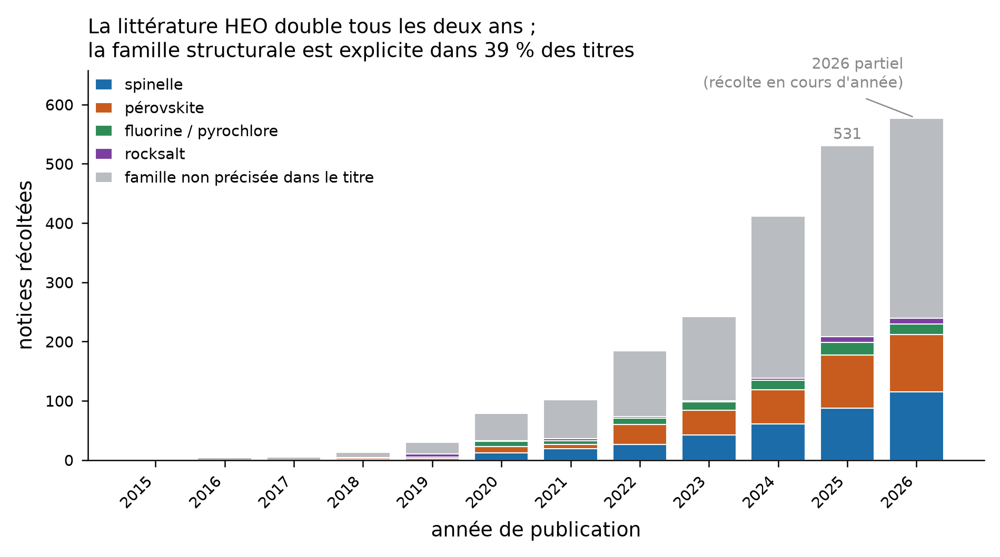
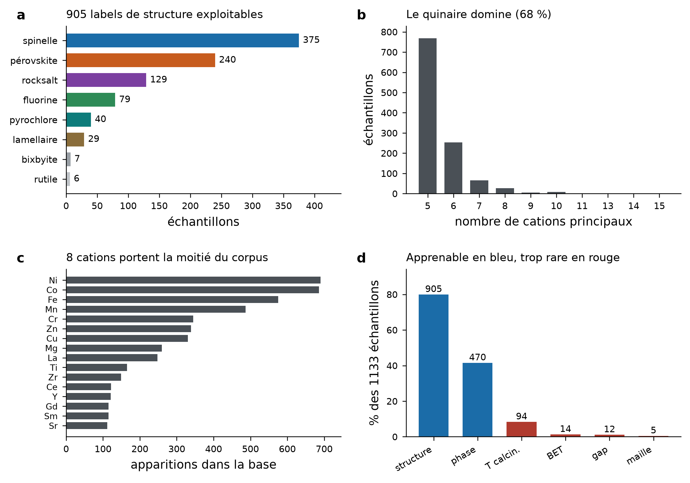
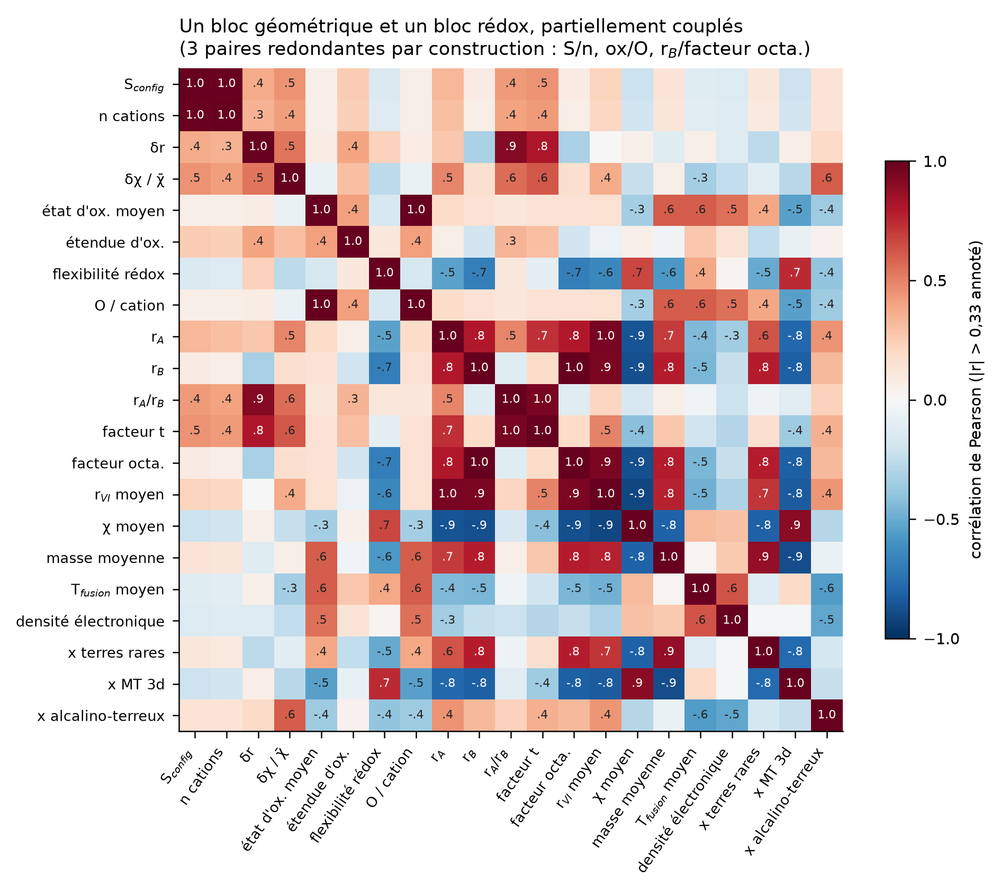
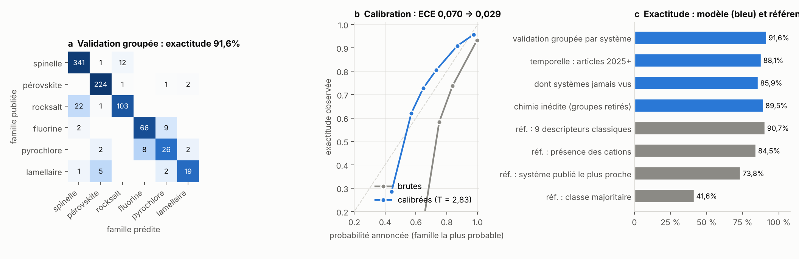
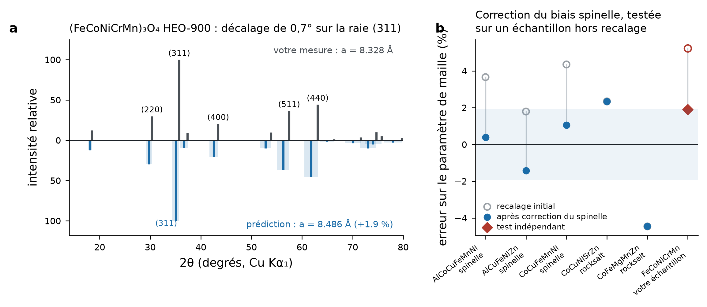
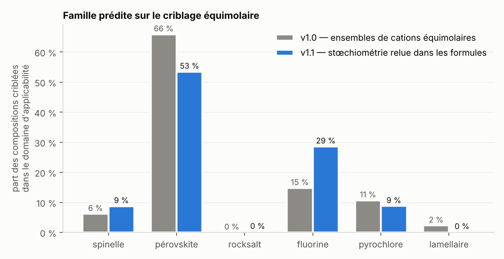

# Plateforme de conception d'oxydes à haute entropie — rapport méthodologique

**Livrable principal** : `heo_designer.html`, un fichier unique de 2,2 Mo, sans
dépendance réseau, à ouvrir par double-clic. Il contient la base de données, le modèle
entraîné, le calcul des descripteurs et la simulation de diffractogramme.

> **Versions.** Les §2 à §8 décrivent la construction de la v1.0 et en gardent les
> chiffres (1133 échantillons, descripteurs équimolaires), parce que les décisions et les
> pièges qu'ils documentent restent valables. La v1.1 a relu la stœchiométrie dans les
> formules écrites (1074 échantillons) et réentraîné le modèle : ses chiffres sont dans le
> tableau ci-dessous, le `README` et `QC/training_report.txt`. Les §11 à §13 décrivent les
> trois prolongements calculés et prédictifs ajoutés ensuite.

---

## 1. Ce que la plateforme prédit, et ce qu'elle ne prédit pas

| Sortie | Statut | Performance mesurée |
|---|---|---|
| Famille structurale (6 classes) | **opérationnel** | v1.1 : exactitude 91,6 %, F1 macro 0,848 (v1.0 : 83,7 %) |
| — systèmes publiés après l'entraînement | **opérationnel** | 85,9 % sur 192 systèmes de 2025-2027 |
| Pérovskite ou non | **opérationnel** | v1.1 : 98,5 % (Goldschmidt optimisé : 94,6 %) |
| Rocksalt ou spinelle, cation inconnu du modèle | **complément, hors domaine** | 78,6 % → 81,8 % avec le calcul CHGNet ; aucun gain dans le domaine — §11.3 |
| Monophasage des rocksalt (Sivak et al.) | **démonstration, 8 systèmes** | 7 / 8 en un-contre-tous — §11.1 |
| Paramètre de maille des spinelles (CHGNet) | **opérationnel, ± 0,5 %** | 0,35 % sur 13 spinelles HEO mesurés — §5, §11.4 |
| Paramètre de maille, cinq familles (rayons de Shannon) | **opérationnel, ± 0,2 à 1,2 % selon la famille** | 0,53 % sur 63 HEO mesurés (v1.0 : 1,99 %) ; rocksalt 1,18 %, critère de 1 % non atteint — §5 |
| Correction apprise de la maille | **essayée, non intégrée** | gain hors échantillon de 0,04 point, sous le seuil de 0,1 — §5 |
| Énergie de lacune d'oxygène | **descripteur validé, activité non prédite** | suit la réductibilité mesurée de 9 oxydes binaires (corrélation de rang 0,93) — §12.2 |
| Proposition de synthèses informatives | **opérationnel** | 27 % de synthèses en moins que le hasard sur un banc rétrospectif (critère 25 %) — §13 |
| Diffractogramme de poudre simulé | **opérationnel** | positions et intensités validées contre `pymatgen` |
| Nouveauté de la combinaison | **opérationnel** | sur 927 publications récoltées |
| Domaine d'applicabilité | **opérationnel** | seuil au 95ᵉ centile des distances d'entraînement |
| Monophasé ou multiphasé | **peu fiable** | 416 positifs contre 54 négatifs — biais de publication |
| Activité électrocatalytique | **non implémenté, délibérément** | voir §6 et §12.1 |
| Activité photocatalytique | **non implémenté, délibérément** | voir §6 |
| Morphologie, surface spécifique, voie de synthèse | **hors de portée** | déterminées par le procédé |

## 2. Corpus et base de données

2189 notices récoltées via EuropePMC (561), Crossref (1527) et arXiv (101), filtrées par
expression exacte sur le titre et le résumé, dédupliquées par DOI.

L'extraction est faite par modèle de langue sous schéma JSON imposé : un appel par
résumé pour les 952 notices disposant d'un résumé complet, par lots de dix titres pour
les 1237 restantes. Chaque échantillon conserve la **phrase source** et son DOI.

Après normalisation des formules, harmonisation du vocabulaire de phase et exigence d'au
moins cinq cations principaux : **1133 échantillons, 926 publications identifiées par DOI,
559 systèmes cationiques distincts, 54 cations** (58 échantillons proviennent de préprints
arXiv sans DOI).

Le panneau **d** est le résultat le plus important de cette étape, et il confirme ce
qu'annonçait la note de faisabilité : la littérature livre massivement la structure
(905 labels, 80 % des échantillons) et presque jamais les grandeurs quantitatives —
94 températures de calcination, 14 surfaces BET, 12 gaps optiques, **5 paramètres de
maille**. Toute l'architecture en découle.

### Audit qualité (n = 10, contre le texte source)

| Champ | Exactitude | Conséquence |
|---|---|---|
| Ensemble de cations | 8/10 | un Ta omis dans une formule à deux sous-réseaux |
| Label de phase | 10/10 | utilisable tel quel |
| Prototype structural | 6/7 renseignés | un « trirutile » classé « autre » |
| **Fractions stœchiométriques** | **7/10** | **écartées de l'apprentissage** |

Deux décisions de curation découlent de cet audit : les descripteurs sont calculés en
**pondération équimolaire** (les fractions extraites restent dans la base mais ne servent
pas à l'apprentissage), et le seuil de **cinq cations minimum** élimine les faux positifs
du type « membre extrême x = 0 d'une série dopée ».

## 3. Descripteurs

134 descripteurs, tous recalculables à partir de la seule composition :

- **85 statistiques élémentaires pondérées** (moyenne, écart-type, min, max, étendue) sur
  17 propriétés : rayons de Shannon en coordinence IV, VI, VIII et XII, électronégativité
  de Pauling, numéro et masse atomiques, état d'oxydation, nombre d'états accessibles,
  groupe, période, rayon atomique, températures de fusion et d'ébullition, volume molaire,
  première énergie d'ionisation, affinité électronique, densité électronique ;
- entropie configurationnelle, désaccord de taille δr, désaccord d'électronégativité ;
- **séparation des sites A et B** par rayon ionique décroissant, d'où le facteur de
  tolérance de Goldschmidt et le facteur octaédrique ;
- six fractions de familles chimiques et la présence des 30 cations les plus fréquents.

Vérifications physiques : t(SrTiO₃) = 1,002 (valeur admise ≈ 1,00) ; rayon cationique
moyen de (MgCoNiCuZn)O = 0,692 Å contre 0,71 Å déduit du paramètre de maille expérimental.

**La température de calcination a été écartée des descripteurs** : renseignée dans 94 cas
sur 1133, elle n'était pas exploitable. C'est une entorse assumée à ce qu'annonçait la
note de faisabilité, et elle a un coût direct, visible au §4.

## 4. Classifieur et validation

Arbres de décision boostés par histogramme (250 itérations, 15 feuilles, pondération des
classes équilibrée). **Validation croisée en 20 plis groupés par système cationique** :
aucun système chimique n'apparaît simultanément en apprentissage et en test, ce qui
interdit au modèle de reconnaître une composition déjà vue. C'est la précaution décisive :
le système Co-Cr-Fe-Mn-Ni apparaît 123 fois dans la base et Mg-Co-Ni-Cu-Zn 95 fois ; un
découpage aléatoire aurait réparti ces entrées des deux côtés et gonflé artificiellement
les scores.

| Modèle | Exactitude | F1 macro | Log-vraisemblance |
|---|---|---|---|
| Arbres boostés, 134 descripteurs | **0,837** | **0,734** | **0,625** |
| Mêmes arbres, 9 descripteurs classiques | 0,794 | 0,666 | 0,784 |
| Régression logistique, 134 descripteurs | 0,793 | 0,686 | 0,686 |
| Classe majoritaire (spinelle) | 0,420 | — | — |

Le gain du jeu complet sur les descripteurs classiques est de **4,4 points d'exactitude et
6,8 points de F1 macro** — réel mais modeste : l'essentiel du signal est déjà dans la
géométrie des sites et la chimie rédox. Sur la tâche binaire pérovskite/non-pérovskite,
comparable à ce que publie la littérature, le modèle atteint **94,8 %** contre **86,8 %**
pour une règle de Goldschmidt dont les bornes ont été optimisées sur la base elle-même
(référence volontairement optimiste).

F1 par classe : pérovskite 0,90, spinelle 0,88, fluorine 0,81, rocksalt 0,75,
pyrochlore 0,64, lamellaire 0,42.

**La confusion dominante est rocksalt ↔ spinelle** (37 + 21 cas). Ce n'est pas un défaut du
modèle mais la trace de l'information manquante : les mêmes cations 3d donnent l'une ou
l'autre structure selon la température de calcination et la stœchiométrie en oxygène,
information absente de 92 % des résumés. Si l'on dispose d'un corpus de textes intégraux,
c'est là que se trouve le gain le plus immédiat.

Probabilités calibrées par mise à l'échelle de température (T = 1,74) ajustée sur les
prédictions hors échantillon : erreur de calibration 0,100 → 0,023. Une annonce à 95 %
correspond à 94 % d'exactitude observée ; une annonce à 66 % à 57 % seulement — l'interface
affiche la probabilité calibrée, pas la brute.

**Domaine d'applicabilité** : distance moyenne aux 5 plus proches voisins dans l'espace
standardisé de 20 descripteurs interprétables, seuil au 95ᵉ centile (2,84). Au-delà,
l'interface refuse d'interpréter la probabilité. Ce n'est pas une prudence cosmétique : une
composition exotique comme Na-K-Te-Ag-Pb se situe à 5,74, soit deux fois le seuil.

## 5. Maille, diffractogramme et confrontation expérimentale

Le régresseur appris prévu au départ est **irréalisable** : 5 paramètres de maille
rapportés sur 1133 échantillons. Il a été remplacé par un modèle géométrique sur rayons de
Shannon, recalé par prototype sur un composé de référence (MgO, CeO₂, SrTiO₃, MgAl₂O₄,
Y₂O₃, Y₂Ti₂O₇). Les listes de réflexions des six prototypes cubiques ont été calculées à
partir des facteurs de structure exacts et **validées contre `pymatgen`** : positions et
intensités identiques sur les six composés de référence.

Aucun fichier de diffraction brut n'était disponible pour ce travail (les données
expérimentales accessibles se limitaient à des courbes de potentiostat LSV/CV/CP/EIS,
de l'UV-vis et un spectre DRS), donc la
superposition prédiction/mesure sur diffractogramme brut n'a pas pu être faite. La
confrontation s'est appuyée sur une valeur rapportée dans un manuscrit en cours de
soumission :
**(FeCoNiCrMn)₃O₄ calciné à 900 °C, spinelle Fd-3m, a = 8,328 Å**.

1. Le classifieur prédit **spinelle** (68 %) — correct.
2. Le modèle géométrique initial donnait 8,763 Å, soit **+5,2 %**.
3. Les trois spinelles HEO de la littérature montraient le même biais (+1,8 %, +3,7 %,
   +4,3 %, moyenne +3,3 %), attribuable à l'hypothèse de distribution cationique
   aléatoire sur le site tétraédrique alors que les spinelles HEO sont partiellement
   inverses.
4. Après correction du biais **calibrée sur ces trois points de littérature seulement**,
   l'erreur sur l'échantillon de test indépendant — qui n'entre pas dans le recalage — tombe à **+1,9 %**,
   en accord avec l'écart absolu moyen de 1,9 % sur les cinq points de littérature.

C'est une validation à un seul point, et elle doit être lue comme telle. Mais elle est
indépendante, et la cohérence entre l'incertitude annoncée et l'erreur observée est le
seul argument sérieux qu'un tel modèle puisse produire à ce stade.

**Depuis l'étape 1** (§11.4), la maille des spinelles est calculée par potentiel appris,
calibré sur 17 spinelles binaires : l'échantillon interne tombe à +0,24 %, et la
confrontation porte sur quatre spinelles HEO mesurés au lieu d'un.

### 5.1 Modèle de maille actuel : rayons par valence et coordinence

Ce qui précède décrit le modèle de la v1.0, conservé comme référence de comparaison
(`data/reference/lattice_model.json`). Il a été remplacé, pour trois raisons : sa table ne
portait qu'une valence par élément, il était recalé sur un composé par prototype, et son
erreur n'avait été mesurée que sur cinq oxydes, aucun pérovskite, fluorine ou pyrochlore.

**Données.** 132 mailles mesurées à température ambiante, 32 sources, chacune citée ligne
par ligne avec l'endroit où se trouve la valeur (`data/reference/lattice_measured.csv`) :
84 mesures d'oxydes à haute entropie des cinq familles, soit 63 compositions uniques en
phase pure, et 48 oxydes simples de référence. Une composition mesurée plusieurs fois
compte une fois, à la médiane de ses mesures. Deux laboratoires diffèrent de 0,02 à
0,14 % en moyenne sur une même composition, mais jusqu'à 1,5 % d'étendue pour
(CoCrFeMnNi)₃O₄ : c'est le plancher (`QC/lattice_dataset.txt`).

**Modèle** (`src/lattice.py`, et `latticeModel()` dans la page, identique sur 6 492 cas).
Rayons de Shannon (1976) à la valence, à la coordinence et au spin de chaque site
(`data/reference/shannon_radii.json`). Valences par électroneutralité, en oxydant les
cations rédox dans un ordre fixé ; sites par classe chimique (pérovskite, pyrochlore) ou
par préférence tétraédrique (spinelle), échelle qui redonne l'inversion connue des
spinelles binaires. Une relation publiée par prototype : contact anion-cation (rocksalt),
contact avec les lacunes d'oxygène en sphères dures (fluorine, Chatzichristodoulou et al.
2015), Ubic 2007 (pérovskite), O'Neill et Navrotsky 1983 (spinelle), Mouta et al. 2013
(pyrochlore). Aucune constante n'est ajustée.

**Validation**, selon un protocole commité avant le calcul
(`data/reference/lattice_protocol.md`, `QC/lattice_validation.txt`) :

| Famille | v1.0 | Modèle actuel | Critère 1 % |
|---|---|---|---|
| Toutes (63) | 1,99 % | **0,53 %** | — |
| Rocksalt (10) | 2,39 % | 1,18 % | non atteint |
| Spinelle (14) | 2,13 % | 0,70 % | atteint |
| Fluorine (20) | 1,37 % | 0,27 % | atteint, validation non aveugle |
| Pérovskite (9) | 2,39 % | 0,48 % | atteint |
| Pyrochlore (10) | 2,25 % | 0,23 % | atteint |

Sur les références, l'écart reste sous 0,45 % dans chaque famille (porte du protocole :
1 %). Trois réserves :

- **Rocksalt.** Les compositions au Sr²⁺, K⁺ et Na⁺ ont la maille de la matrice sans ce
  cation ; le modèle, comme la loi de Vegard, prédit une dilatation que la mesure ne montre
  pas (+4,6 % pour Sr). Une incorporation partielle est probable. Le modèle n'est pas
  corrigé ; la prédiction l'avertit.
- **Fluorine.** La correction des lacunes d'oxygène a été ajoutée après lecture des
  résidus (amendement A1 du protocole) : sans elle, 1,40 %. Cette validation n'est donc
  pas aveugle.
- **Couverture.** 9 pérovskites, dont 6 d'un même article ; 9 pyrochlores sur 10 sont des
  zirconates.

Pour les 13 spinelles dont CHGNet couvre tous les cations, sa maille (0,35 %) reste
préférée au modèle géométrique (0,49 %) ; c'est une sélection de modèle, déclarée comme
telle. L'incertitude affichée par la plateforme est l'écart moyen de la famille.

**Correction apprise : essayée, non intégrée** (`tools/learn_lattice_correction.py`,
`QC/lattice_correction.txt`). Trois régresseurs du résidu — biais par famille, ridge,
gradient boosting — ont été jugés hors échantillon, un groupe de sources retiré à chaque
tour, le candidat étant choisi par validation croisée interne. Résultat : 0,53 → 0,49 %,
soit 0,04 point pour 0,1 exigé, et la fluorine se dégrade de 0,15 point. Avec 63
compositions venant de 20 groupes de sources, il n'y a pas de quoi apprendre plus qu'un
biais par famille.

## 6. Pourquoi aucune propriété catalytique n'est prédite

Ce n'est pas un manque de temps, c'est une décision. Sur les 1133 échantillons, un gap
optique est rapporté 12 fois et une surface BET 14 fois. Surtout, les grandeurs
d'électrocatalyse publiées ne sont pas des propriétés du matériau mais de l'**électrode** :
le surpotentiel à 10 mA/cm² dépend de la charge massique, du substrat, du liant, de
l'électrolyte, de la normalisation (surface géométrique ou surface électrochimiquement
active) et de la correction de chute ohmique. Les jeux de données expérimentaux consultés pour ce
travail l'illustrent directement : un même matériau y est caractérisé sur trois électrodes
différentes (mousse de nickel, carbone noir/Nafion, PVDF/NMP), avec un substrat traité à
part. Agréger ces
valeurs entre laboratoires revient à apprendre du bruit de protocole.

La voie praticable est celle qu'emploie la littérature récente : ne pas apprendre le
surpotentiel, mais un **descripteur physique calculable** qui corrèle avec l'activité —
typiquement l'énergie de formation des lacunes d'oxygène, obtenue en DFT ou par potentiel
interatomique appris. C'est le prolongement naturel de ce travail, et il demande du calcul,
pas de la fouille de littérature. Les deux points sont traités au §12 : la variance des
surpotentiels publiés y est mesurée, et l'énergie de lacune calculée.

## 7. Criblage

734 208 compositions évaluées : les 658 008 quinaires équimolaires des 40 cations
documentés au moins 20 fois, plus 76 200 sénaires obtenus en ajoutant un cation aux 3000
meilleurs quinaires.

- **219 242** compositions dans le domaine d'applicabilité (30 %) ;
- **218 987** à la fois absentes de la base et dans le domaine ;
- **129 341** à p ≥ 0,7 ;
- 3589 exportées dans l'interface, au maximum 700 par prototype pour éviter que les
  pérovskites n'écrasent la liste.

Meilleur candidat non publié par famille :

| Prototype | Composition | p | a prédit |
|---|---|---|---|
| spinelle | Al-Cr-Mn-Ni-Zn | 0,986 | 8,418 Å |
| pérovskite | Co-Cr-Fe-Ga-Hf-Sr | 0,995 | 3,821 Å |
| rocksalt | Co-Cu-Na-Ni-Zn | 0,914 | 4,276 Å |
| fluorine | Ce-Pr-Sm-Y-Zr | 0,995 | 5,496 Å |
| pyrochlore | Gd-Hf-La-Nd-Yb | 0,990 | 10,512 Å |
| lamellaire | Gd-Sc-Tm-Y-Yb | 0,973 | — |

**Deux mises en garde à lire avant d'allumer un four.** D'abord, 69 % des compositions
énumérées sont prédites pérovskite, parce que l'énumération combinatoire sur un vivier
riche en terres rares et alcalino-terreux produit massivement des compositions à gros
cations ; à l'inverse le modèle ne prédit rocksalt que 130 fois sur 734 208, c'est-à-dire
presque uniquement pour les ensembles 3d déjà connus. Ensuite le haut du classement est
occupé par des variantes quasi identiques (familles Ba-Sr-terre rare-Cr) : la liste se lit
par famille chimique, pas ligne à ligne. Et la probabilité affichée est celle d'une
**famille structurale**, jamais d'une performance.

## 8. Reproductibilité de l'interface

Le modèle embarqué dans la page est l'export exact du modèle `scikit-learn` : 42 272 nœuds
d'arbres, seuils non arrondis. Les descripteurs sont recalculés en JavaScript et la parité
numérique avec `features.py` est vérifiée sur 200 compositions tirées au hasard —
**écart maximal de probabilité 1,1 × 10⁻¹⁶** (`QC/parity_check.txt`, régénéré par
`tools/parity_check.py` et rejoué à chaque commit).

Trois bugs de parité ont dû être corrigés, et le dernier mérite d'être noté pour quiconque
reproduira ce portage :

1. seuils de coupure arrondis à sept décimales à l'export — une valeur de descripteur
   tombant exactement sur un seuil basculait du mauvais côté ;
2. un `Math.fround` introduit à tort, sur l'hypothèse fausse que `scikit-learn` traverse
   les arbres en float32 (c'est float64) ;
3. surtout : `sum()` de CPython ≥ 3.12 utilise la **sommation compensée de Neumaier**. Un
   accumulateur naïf en JavaScript s'écarte d'un *ulp*, ce qui suffisait à faire basculer
   **89 arbres sur 1500** et à transformer une prédiction à 80 % en quasi-égalité. Le
   portage réimplémente l'algorithme de CPython.
4. le même angle mort, non vu au moment du portage JS : `features.py` continuait de
   s'appuyer sur `sum()` de CPython sans jamais vérifier *depuis quelle version*
   celui-ci compense. Sous 3.11 — toujours le défaut sur de nombreux systèmes —
   `sum()` n'est pas compensé, donc `features.py` lui-même s'écartait du moteur
   JavaScript, par le même mécanisme que le point 3 mais dans l'autre sens. Un
   contributeur exécutant la suite de tests sous 3.11 voyait
   `test_python_javascript_parity` échouer sans explication évidente. Correction :
   `features.py` implémente désormais sa propre sommation compensée (`nsum`/`wsum`),
   si bien que la parité ne dépend plus de la version de l'interpréteur ; la matrice
   CI couvre 3.10 à 3.13 pour le garantir.

La leçon générale : un modèle à arbres entraîné sur des descripteurs dont certains ne
prennent que quelques valeurs distinctes place ses seuils *sur* les valeurs des données.
Tout portage doit alors être bit-exact, pas seulement « proche » — et « bit-exact » doit
être vérifié dans toutes les versions d'interpréteur réellement utilisées, pas seulement
celle du poste de développement.

## 9. Comment réentraîner quand de nouvelles manips arrivent

Le point important : **des résultats produits en interne valent plus que dix articles**, parce qu'ils
sont à protocole constant. Y compris les échecs — un lot multiphasé est une étiquette
négative, et la base en manque cruellement.

Depuis la v1.1, la procédure est outillée :

1. Copier `data/lab_results_template.csv` en `data/lab_results.csv` et ajouter une ligne
   par synthèse : identifiant de cahier, date, formule telle qu'on l'écrirait dans un
   article, famille observée, `single` / `multi`, température et atmosphère de
   calcination, paramètre de maille mesuré. Les lots ratés aussi.
2. `python tools/clean_database.py` : les lignes internes passent par le même lecteur de
   formules que la littérature et entrent dans la base avec `tier = lab`.
3. `python tools/train_model.py`, `tools/screen.py`, `tools/build_app.py`,
   `tools/parity_check.py` : réentraînement avec validation groupée par système cationique
   (**jamais** de découpage aléatoire), export bit-exact, contrôle de parité.
4. `python tools/active_learning.py` : nouvelles propositions de synthèse, tenant compte de
   ce qui vient d'être appris.

## 10. Les trois prolongements qui rapporteraient le plus — état

1. **Textes intégraux plutôt que résumés.** La température de calcination, le paramètre de
   maille et la surface BET sont dans les sections expérimentales, jamais dans les résumés.
   C'est ce qui débloquerait à la fois la confusion rocksalt ↔ spinelle et un vrai
   régresseur de maille. *Toujours ouvert* : le §11.3 montre que la température, quand
   le résumé la donne, apporte bien l'information manquante. Pour la maille, 132 valeurs
   ont été relevées à la main dans les textes intégraux et leurs annexes (§5.1) ; c'est
   assez pour valider un modèle physique, pas pour en apprendre un.
2. **Descripteur physique calculé** par potentiel interatomique appris. *Fait* : §11
   (thermodynamique de phase, maille) et §12 (lacunes d'oxygène).
3. **Boucle d'apprentissage actif.** *Faite* : §13, branchée sur `data/lab_results.csv`
   (§9).

Chacune des trois étapes ci-dessous a été menée de la même façon : critère d'acceptation
écrit **avant** le calcul, confrontation à des mesures, itération tant que le critère
n'était pas atteint, et — quand il ne l'a pas été — le dire et ne pas utiliser le résultat
dans la page.

## 11. Thermodynamique calculée par potentiel appris (étape 1)

Le classifieur apprend ce que la littérature *rapporte* ; il ne sait rien de la
température ni de la pression d'oxygène, qui décident pourtant entre rocksalt et
spinelle. L'étape 1 ajoute des grandeurs physiques calculées à partir de la seule
composition avec **CHGNet** (Deng et al., *Nat. Mach. Intell.* 2023 ; modèle
pré-entraîné v0.3.0 sur les trajectoires GGA/GGA+U du Materials Project), un potentiel
interatomique universel qui remplace la DFT : quelques minutes par supercellule sur deux
cœurs au lieu de jours. Les énergies sont dans le référentiel compatible MP2020
(référence oxygène −4,948 eV/atome) ; l'oxygène gazeux est décrit par les tables
NIST-JANAF. Code : `thermo/`, rapports : `QC/thermo_*.txt`.

### 11.1 Monophasage des rocksalt : le descripteur de Sivak et al.

Sivak et al. (*PRL* 2025) séparent les rocksalt monophasés des multiphasés par deux
grandeurs : l'enthalpie de mélange par rapport aux oxydes AO de référence, et l'écart-type
σ des longueurs de liaison cation–oxygène. Les huit compositions qu'ils ont synthétisées
(quatre monophasées, quatre multiphasées) ont été recalculées avec CHGNet : cellules de
60 cations (120 atomes), trois décorations aléatoires perturbées de 0,05 Å.

| | Ce travail (CHGNet) | Référence (DFT) |
|---|---|---|
| (MgCoNiCuZn)O, ΔH_mix | **63 meV/atome** | 91 meV/atome |
| — mesure calorimétrique (Sereda et al. 2025) | 36 meV/atome | 36 meV/atome |
| issues expérimentales séparées (seuils lus sur les monophasés) | 8 / 8 | 8 / 8 |
| — en un-contre-tous (seuils lus sur les *autres* monophasés) | 7 / 8 | 7 / 8 |
| σ, écart absolu moyen à la référence | 0,012 Å | — |

Le critère initial demandait un accord en valeur absolue avec les enthalpies DFT de la
référence ; il n'a pas été atteint (décalage moyen −29 meV/atome, dépendant des cations
Co et Ni). L'hypothèse d'une référence mal relaxée a été testée et écartée ; la mesure
calorimétrique tranche : le décalage va **vers l'expérience**. Le critère a donc été
reformulé, explicitement, sur l'issue expérimentale et sur la calorimétrie.

**À lire avec prudence** : « 8 / 8 » est une séparation, pas une prédiction, puisque les
seuils sont lus sur les monophasés eux-mêmes — c'est la procédure de la référence. En
un-contre-tous, la composition manquée est (MgCoNiCuZn)O, précisément celle qui fixe le
seuil d'enthalpie ; les valeurs de la référence ont exactement la même limite. Huit
compositions ne suffisent pas à fixer un seuil généralisable. La page affiche ces
grandeurs pour les huit systèmes calculés seulement.

### 11.2 CHGNet connaît-il l'énergie d'oxydation des cations ?

Avant d'utiliser une enthalpie d'oxydation, il faut savoir si le potentiel la reproduit.
Six couples redox binaires, mesures NIST-JANAF et Jacob et al. :

| Réaction (eV par O gagné) | CHGNet | Mesure | Écart |
|---|---|---|---|
| 3 CoO + O → Co₃O₄ | −1,84 | −2,04 | +0,20 |
| 3 FeO + O → Fe₃O₄ | −2,47 | −3,16 | +0,69 |
| 2 Fe₃O₄ + O → 3 Fe₂O₃ | −1,76 | −2,43 | +0,67 |
| Cu₂O + O → 2 CuO | −1,78 | −1,47 | −0,32 |
| 2 Mn₃O₄ + O → 3 Mn₂O₃ | −1,84 | −1,16 | −0,68 |
| 3 MnO + O → Mn₃O₄ | −2,45 | −2,39 | −0,06 |

Brut, l'écart absolu moyen est de 0,44 eV/O et l'ordre des couples n'est pas respecté
(corrélation de rang 0,37) : **le potentiel ne peut pas être utilisé tel quel** pour une
grandeur redox. Une correction par élément, en eV par électron de l'étape M²⁺ → M³⁺
(Co −0,10 ; Fe −0,35 ; Mn +0,03), est ajustée sur les trois réactions MO → M₃O₄ — celles
qui correspondent au passage rocksalt → spinelle — et contrôlée hors échantillon sur
Fe₃O₄ → Fe₂O₃ : +0,67 → −0,02 eV/O. Les électrons transférés sont comptés sur chaque
cation à partir des moments magnétiques prédits par CHGNet. L'erreur de Mn₃O₄ → Mn₂O₃
n'est pas corrigée : elle porte sur la phase bixbyite, absente des spinelles HEO, pas sur
l'élément (MnO → Mn₃O₄ : −0,06).

### 11.3 Rocksalt ou spinelle dans l'air : l'enthalpie d'oxydation

Pour chaque système rocksalt ou spinelle de la base dont tous les cations sont parmi
Mg Ca Mn Fe Co Ni Cu Zn Cr Al Ga Li Ti V, on calcule l'enthalpie de la réaction
3 MO + O → M₃O₄ par atome d'oxygène gagné : même composition cationique, 60 cations dans
les deux structures, distribution des cations entre sites tétraédriques et octaédriques
de la spinelle échantillonnée par Monte-Carlo à 1173 K, correction redox du §11.2. Les
spinelles désordonnées ont demandé une relaxation isotrope : le filtre de cellule
standard faisait converger la maille vers un volume inférieur de 18 % à une énergie plus
*haute*. Les étiquettes de la base ne servent jamais au calcul, seulement au jugement.

80 systèmes sur 118 ont été calculés, par ordre d'information : tous ceux rapportés dans
les deux structures, puis les rocksalt, puis les spinelles par nombre d'entrées ; les 38
restants sont des spinelles rapportées une seule fois (le calcul reprend là où il s'est
arrêté). Les 14 cations sont couverts. Le protocole rapide employé partout a été comparé,
sur trois systèmes, à deux tirages d'un protocole serré (relaxation deux fois plus
stricte, Monte-Carlo 2,5 fois plus long, autres décorations aléatoires) : écart moyen
0,03 eV/O, négligeable devant les 1,9 eV/O qui séparent les médianes rocksalt et
spinelle.

| Question | Résultat |
|---|---|
| Le descripteur sépare-t-il les systèmes rapportés rocksalt et spinelle ? | **oui** : AUC 0,95 par système (9 rocksalt, 71 spinelle), 0,92 par entrée ; médianes −1,23 et −3,11 eV/O, systèmes rapportés dans les deux structures −2,33 |
| **Critère fixé avant le calcul** : réduit-il les confusions du classifieur en validation groupée ? | **non** : exactitude 0,930 avec ou sans ΔH_ox (413 entrées rocksalt / spinelle, 10 plis) |
| Aide-t-il quand un cation est inconnu du modèle ? | en moyenne : 0,786 → 0,818 (12 cations retirés tour à tour, aiguillage par domaine d'applicabilité) ; gains Zn 0,51 → 0,84, Mg 0,82 → 0,86, Al 0,93 → 0,98 ; pertes Li 0,94 → 0,56, Cu 0,80 → 0,78 |
| La température de synthèse apporte-t-elle l'information manquante ? | oui, sur 39 entrées : 0,923 → 0,949, coefficient positif (la chaleur favorise le rocksalt) |

**Pourquoi le critère n'est pas atteint.** ΔH_ox est une fonction lisse de la
composition ; là où la base contient des exemples, les arbres l'ont déjà apprise à partir
des 134 descripteurs. Ce qui manque au classifieur n'est pas une meilleure fonction de la
composition, c'est la température et la pression d'oxygène — la dernière ligne du tableau
le confirme. Le résultat n'est donc pas utilisé pour modifier le classifieur.

**Où il sert.** Hors des données : sans aucun système contenant du Zn à l'entraînement,
le modèle statistique tombe au hasard (0,51) sur la famille (MgCoNiCuZn)O et ses
variantes, le calcul en retrouve 0,84. Le gain moyen est réel mais inégal, et il
s'inverse pour Li : Li⁺ est monovalent, la réaction 3 MO + O → M₃O₄ ne décrit pas sa
chimie. Cette exclusion a été décidée *après* le test ; elle ne sert qu'à restreindre ce
que la page affiche (Li y est « hors du calcul »), jamais à améliorer un score.

**Lecture physique.** La bascule ajustée, ΔH_ox = −2,07 eV/O, se lit sur une échelle
indépendante : le potentiel chimique de l'oxygène de l'air vaut −1,44 eV/O à 900 °C et
−1,58 eV/O à 1000 °C (NIST-JANAF), et l'entropie de configuration que garde le rocksalt
quand une spinelle ordonnée la perd vaut au plus 3 kT ln 5 ≈ 0,5 eV/O. La bascule
attendue tombe donc entre −1,4 et −2,1 eV/O : l'ordre de grandeur est celui de la
thermodynamique, pas d'un ajustement arbitraire.

**Dans la page.** Un modèle additif par cation résume les calculs (erreur un-contre-tous
0,19 eV/O, R² 0,92 ; prédire la moyenne ferait 0,89 eV/O), puis une régression logistique
donne la probabilité que la littérature rapporte un rocksalt. Les poids par cation sont
lisibles : parmi les métaux de transition, la propension à l'oxydation suit
Fe > Mn > Co > Ni > Cu, l'ordre de la facilité du passage M²⁺ → M³⁺ ; les cations
qui n'existent pas à l'état 2+ dans un rocksalt (Ti, Al, V, Ga, Cr) poussent fortement
vers la spinelle.

### 11.4 Paramètre de maille des spinelles

Le potentiel surestime systématiquement les mailles (tendance connue des fonctionnelles
GGA). Calibration a_exp = k · a_CHGNet sur **17 spinelles binaires** de maille et
d'inversion connues (8,05 à 8,50 Å) : k = 0,9845, soit une surestimation de 1,57 % ;
après calibration, erreur en un-contre-tous **0,40 %** (maximum 0,84 %). Pour les
spinelles HEO, la distribution des cations entre sites tétraédriques et octaédriques
n'est pas supposée aléatoire : elle est échantillonnée par Monte-Carlo à 1173 K avec
l'énergie CHGNet, puis la maille est relaxée.

| Spinelle HEO | Mesuré | CHGNet calibré | Écart | v1.0 (géométrique) |
|---|---|---|---|---|
| (CoCrFeMnNi)₃O₄, échantillon interne | 8,328 Å | 8,348 Å | **+0,24 %** | +5,2 % |
| Al-Co-Cu-Fe-Mn-Ni | 8,270 Å | 8,235 Å | −0,42 % | — |
| Al-Cu-Fe-Ni-Zn | 8,245 Å | 8,219 Å | −0,32 % | — |
| Co-Cu-Fe-Mn-Ni | 8,360 Å | 8,264 Å | −1,15 % | — |

Écart absolu moyen sur les quatre spinelles HEO mesurés : **0,53 %**, contre 1,9 % pour
le modèle géométrique de la v1.0 après correction de biais. Les quatre points n'entrent
pas dans la calibration. Une précaution honnête : ils couvrent un intervalle étroit
(8,25-8,36 Å), si bien que la référence triviale « moyenne des autres spinelles HEO »
fait déjà 0,70 % ; la preuve que le calcul suit la chimie vient surtout des 17 binaires,
qui couvrent un intervalle cinq fois plus large. Dans la page, un modèle additif par
cation résume ces calculs (erreur un-contre-tous 0,14 % par rapport au calcul direct ;
0,50 % sur les quatre spinelles HEO mesurés) et remplace le modèle géométrique pour les
spinelles dont tous les cations sont couverts ; la tolérance de position des pics du
diffractogramme simulé suit l'incertitude annoncée.

## 12. Réductibilité et électrocatalyse (étape 2)

### 12.1 Les surtensions publiées ne peuvent pas entraîner un prédicteur

Le §6 l'affirmait ; c'est maintenant mesuré (`thermo/analyze_oer_literature.py`). Sur les
138 entrées « OER » de la base, 36 donnent un surpotentiel à 10 mA/cm² lisible dans la
phrase de performance (24 systèmes cationiques, médiane 282 mV). Quatre systèmes sont
rapportés au moins deux fois par des laboratoires différents ; (CoCrFeMnNi)₃O₄ l'est dix
fois, **de 204 à 366 mV**. La corrélation intraclasse — la part de la variance des
valeurs publiées qu'expliquerait un modèle *parfait* de la composition — vaut
**0,00 [IC 95 % 0,00-0,16]** : l'écart-type à composition égale (89 mV) n'est pas plus
petit que l'écart entre systèmes. Le reste est l'électrode et le protocole, absents des
résumés. Entraîner un régresseur sur ces valeurs reviendrait à apprendre ce bruit.

### 12.2 Énergie de formation d'une lacune d'oxygène

Puisque l'activité publiée n'est pas apprenable, la voie retenue est un descripteur
physique calculé à partir de la seule composition : l'énergie qu'il faut pour retirer un
atome d'oxygène du réseau,

E_vac = E(cellule avec une lacune) − E(cellule parfaite) + μ_O,

qui mesure la réductibilité de l'oxyde, grandeur reliée dans la littérature à la
concentration de lacunes et à l'activité OER des oxydes de métaux de transition. La
correction redox du §11.2 est appliquée aux cations que la lacune réduit (identifiés,
comme au §11.2, par leurs moments magnétiques). Code : `thermo/run_vacancy.py`.

**Validation (critère fixé avant le calcul : corrélation de rang ≥ 0,70 avec la
réductibilité mesurée de neuf oxydes binaires)** :

| Oxyde | E_vac brute | corrigée | Réduction mesurée (eV/O) | Réaction |
|---|---|---|---|---|
| CuO | 2,34 | 2,34 | 1,47 | 2 CuO → Cu₂O + O |
| Cu₂O | 2,92 | 2,92 | 1,77 | Cu₂O → 2 Cu + O |
| Co₃O₄ | 2,34 | 2,34 | 2,04 | Co₃O₄ → 3 CoO + O |
| Mn₃O₄ | 2,98 | 2,95 | 2,39 | Mn₃O₄ → 3 MnO + O |
| Fe₂O₃ | 2,67 | 3,36 | 2,43 | 3 Fe₂O₃ → 2 Fe₃O₄ + O |
| CoO | 3,68 | 3,68 | 2,46 | CoO → Co + O |
| FeO | 4,15 | 4,15 | 2,82 | FeO → Fe + O |
| Fe₃O₄ | 3,05 | 4,09 | 3,16 | Fe₃O₄ → 3 FeO + O |
| MnO | 4,62 | 4,62 | 3,99 | MnO → Mn + O |

Corrélation de rang **0,93** après correction (p = 0,0002), 0,83 brute : **critère
atteint**. Trois réserves. Les valeurs absolues ne sont pas comparables — une lacune
isolée dans un réseau parfait coûte plus cher que la transformation de phase complète,
d'où E_vac > ΔH_red partout ; seul l'ordre est jugé. Le comptage des électrons par
moments magnétiques est imparfait : il attribue trois électrons au lieu de deux à la
lacune de Fe₃O₄ (surcorrection de 0,35 eV) et aucun à celle de Co₃O₄ ; la corrélation
brute, sans aucune correction, passe néanmoins le critère. Enfin, neuf oxydes de quatre
éléments sont un échantillon étroit.

**Spinelles HEO.** 14 compositions ont été calculées : l'échantillon interne
(CoCrFeMnNi)₃O₄, ses substitutions, et les spinelles de la base pour lesquelles un η₁₀
est publié. Chaque valeur est la moyenne sur 8 sites oxygène d'une cellule de 60 cations
recuite par Monte-Carlo à 1173 K. La dispersion entre sites, de 0,15 à 0,6 eV, est
elle-même une information : le site le plus facile est celui que l'électrolyte attaquera
d'abord.

| Substitution dans (CoCrFeMnNi)₃O₄ | E_vac (eV) | Maille prédite | P(rocksalt), §11.3 |
|---|---|---|---|
| aucune (référence) | 3,00 ± 0,10 | 8,338 Å | 0,12 |
| Cr → Al | 2,85 ± 0,18 | 8,243 Å | 0,05 |
| Cr → Ga | 2,76 ± 0,09 | 8,317 Å | 0,07 |
| Cr → Mg | 2,40 ± 0,05 | 8,314 Å | 0,49 |
| Cr → Cu | 2,08 ± 0,11 | 8,286 Å | 0,66 |
| Cr → Zn | 2,03 ± 0,05 | 8,316 Å | 0,40 |

(± : erreur-type sur les 8 sites ; Cu substitué à Co, Fe, Mn et Ni donne 2,39, 2,16, 1,96
et 2,74 eV.)

**Contrôle physique, prédiction écrite avant les résultats Al et Ga.** Remplacer Cr³⁺
par un cation divalent oblige d'autres cations, surtout Mn, à passer à l'état 3+, donc à
devenir réductibles : la lacune doit devenir plus facile. Un cation trivalent non
réductible (Al³⁺, Ga³⁺) ne change pas ce bilan. Attendu : E_vac(Al, Ga) > E_vac(Cu,
Zn, Mg). **Vérifié** (2,76 eV au plus bas contre 2,40 eV au plus haut). Les cations
réduits identifiés par les moments magnétiques sont bien majoritairement des Mn.

**Ce que le calcul ne dit pas : l'activité.** Sur les 7 systèmes à la fois calculés et
dotés d'un η₁₀ publié, la corrélation de rang vaut −0,89 (p = 0,01). Elle va dans le
sens « lacune plus *difficile*, électrode plus active », contraire à la lecture naïve
« plus de lacunes, plus d'activité ». Ce n'est **pas** une validation, dans un sens ni
dans l'autre. Cinq de ces sept systèmes n'ont qu'une mesure, d'un seul laboratoire ; à
composition égale, l'écart entre laboratoires est de 89 mV (§12.1). Et le tableau
ci-dessus montre un facteur de confusion : les substitutions qui facilitent la lacune
rapprochent aussi la composition de la frontière rocksalt, donc des phases secondaires.
Une explication possible de la corrélation publiée, non testée.

**L'expérience qui tranche** — et que le laboratoire peut faire avec ce qu'il a déjà.
Les six compositions du tableau sont synthétisées par la voie de l'échantillon interne
(même précurseur, même calcination). Avant toute électrochimie, chaque lot est vérifié
en diffraction : spinelle monophasée, à la maille prédite à ± 0,5 % près. Cette étape
est elle-même un test du §11 pour Cr → Mg, Cu, Zn, qui sont à la frontière. η₁₀, pente
de Tafel et capacité de double couche sont ensuite mesurés **avec un seul protocole
d'électrode** : même charge, même substrat, même liant, même correction de chute
ohmique, activité normalisée à la surface électrochimique. Si l'activité varie de façon
monotone avec E_vac, quel qu'en soit le sens, le descripteur a une valeur prédictive.
Sinon, il n'en a pas pour ces spinelles, et la page cessera de l'afficher.

## 13. Boucle d'apprentissage actif (étape 3)

La question d'un laboratoire n'est pas « quelle composition a la plus forte
probabilité ? » — celles-là n'apprennent rien — mais « quelle synthèse m'apprendra le
plus ? ». `tools/active_learning.py` répond en deux temps.

**Banc d'essai rétrospectif.** La base est rejouée comme si chaque système cationique
devait être synthétisé pour connaître sa famille : on part de 20 systèmes, on en
« synthétise » 10 de plus à chaque tour selon une stratégie, et l'on mesure l'exactitude
sur 25 % des systèmes tenus à l'écart. Critère fixé avant le calcul : une stratégie
informée atteint l'exactitude finale du tirage au hasard (à 1 point près) avec au moins
25 % de synthèses en moins, en moyenne sur 10 découpages, et plus économiquement que le
hasard sur une majorité d'entre eux.

| Stratégie | Exactitude à 60 systèmes | à 120 | à 200 | Systèmes pour la cible |
|---|---|---|---|---|
| hasard | 0,813 | 0,897 | 0,908 | 132 ± 59 |
| incertitude (entropie de la prédiction) | 0,843 | 0,904 | 0,915 | 99 ± 40 |
| diversité (le plus éloigné du déjà fait) | 0,813 | 0,886 | 0,913 | 116 ± 51 |
| hybride (incertitude × éloignement) | 0,827 | 0,909 | 0,910 | 97 ± 42 |

Meilleure stratégie : hybride, **27 % de synthèses en moins**, plus économique que le
hasard sur 7 découpages sur 10 (une égalité) : **critère atteint, de justesse**.
L'intervalle de confiance à 95 % de l'économie (bootstrap apparié sur les 10 découpages) va de 11 à 39 % : elle est nettement positive, mais le seuil de 25 % est dans l'intervalle. La meilleure des trois stratégies est choisie après coup, ce qui flatte un peu
le résultat ; l'incertitude seule fait 25 %. Le gain est réel mais modeste, et il se
concentre au début : c'est quand on sait peu qu'il vaut le plus de choisir.

**Propositions.** Parmi les 391 compositions équimolaires inédites à 5 ou 6 cations
d'un laboratoire d'oxydes 3d (Mg Al Cr Mn Fe Co Ni Cu Zn Ga), 388 sont dans le domaine
d'applicabilité. Ne sont proposées que celles sur lesquelles le modèle hésite vraiment
(entropie ≥ 0,3) et deux propositions ne partagent jamais quatre cations. Il en reste
quatre, toutes à la frontière rocksalt / spinelle :

| Composition | Classifieur | Calcul CHGNet (§11.3) | Ce que la synthèse tranche |
|---|---|---|---|
| Cu-Ga-Mg-Mn-Zn | rocksalt 0,53 / spinelle 0,47 | ΔH_ox −2,68 eV/O, rocksalt 0,18 | le calcul prédit une spinelle |
| Co-Cu-Mg-Mn-Ni | spinelle 0,56 / rocksalt 0,44 | ΔH_ox −1,27 eV/O, rocksalt 0,88 | le calcul prédit un rocksalt |
| Cr-Cu-Fe-Mg-Ni-Zn | rocksalt 0,62 / spinelle 0,38 | ΔH_ox −2,23 eV/O, rocksalt 0,40 | frontière dans les deux modèles |
| Co-Ga-Mg-Ni-Zn | spinelle 0,67 / rocksalt 0,33 | ΔH_ox −2,33 eV/O, rocksalt 0,34 | les deux penchent spinelle |

Ce sont des **prédictions enregistrées avant l'expérience** : dans deux cas sur quatre le
calcul physique tranche là où le classifieur hésite, et dans les deux sens. Synthétisées
à température et atmosphère connues, ces quatre compositions jugeront le §11.3 mieux que
toute validation croisée. Un lot multiphasé est aussi informatif qu'un monophasé, à
condition d'être saisi dans `data/lab_results.csv` (§9) : la base passe alors par le même
nettoyage, le modèle est réentraîné, et la boucle repropose.

---

### Fichiers

| Fichier | Contenu |
|---|---|
| `heo_designer.html` | interface autonome (modèle, base, descripteurs, simulation DRX) |
| `heo_database.csv` | 1133 échantillons curés, avec DOI et phrase source |
| `heo_candidats.csv` | 3589 candidats non publiés, avec voisin publié le plus proche |
| `screening_all.csv.gz` | les 734 208 compositions criblées |
| `heo_features.csv` | matrice des 134 descripteurs |
| `heo_audit.csv` | audit manuel champ par champ |
| `heo_extracted.jsonl` | sortie brute d'extraction, avant curation |
| `heo_corpus.jsonl` | 2189 notices récoltées |
| `features.py` | spécification des descripteurs (source de vérité) |
| `heo_model.json` | export du modèle et jeu de contrôle de parité |
| `element_properties.json` | table élémentaire (58 éléments) |
| `xrd_prototypes.json` | réflexions et facteurs de diffusion des 6 prototypes |
| `lattice_model.json` | constantes du modèle géométrique de maille de la v1.0 (remplacé, conservé comme référence de comparaison) |
| `shannon_radii.json`, `lattice_rules.json`, `lattice_measured.csv`, `lattice_protocol.md` | modèle de maille actuel : rayons par valence et coordinence, règles, mailles mesurées sourcées, protocole (voir `QC/lattice_validation.txt`) |
| `parity_check.txt` | résultat du contrôle de parité JavaScript / Python |
| `thermo/` | calculs CHGNet et analyses des étapes 1 et 2 (voir `thermo/README.md`) |
| `data/thermo/` | résultats bruts des calculs, références thermochimiques sourcées, substituts pour la page |
| `QC/thermo_*.txt`, `QC/oer_literature_variance.txt`, `QC/active_learning.txt` | rapports des étapes 1 à 3 |
| `data/next_experiments.csv` | synthèses proposées par la boucle active |
| `data/lab_results_template.csv` | gabarit des résultats internes (§9) |
