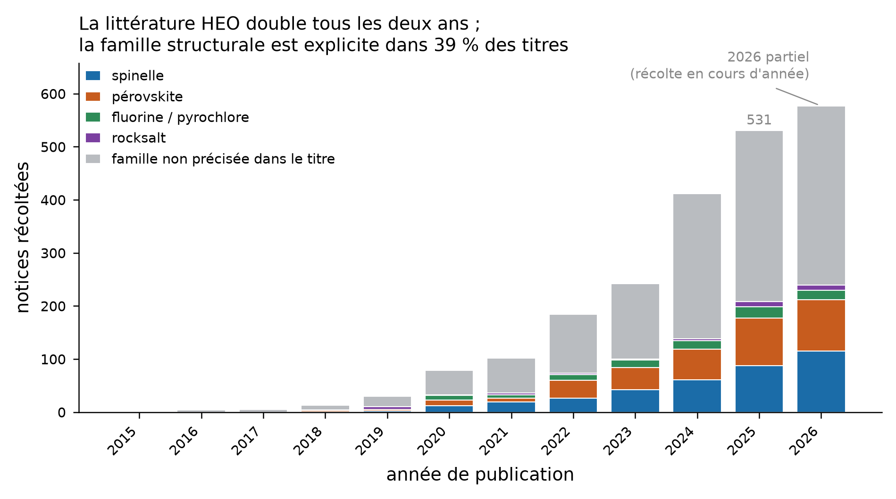
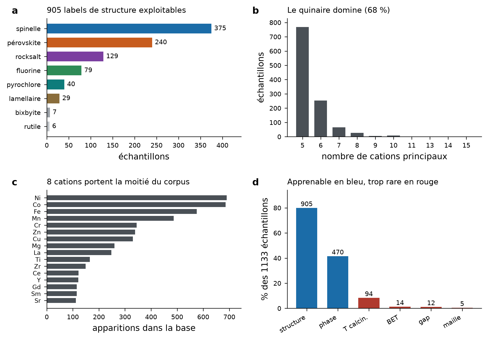
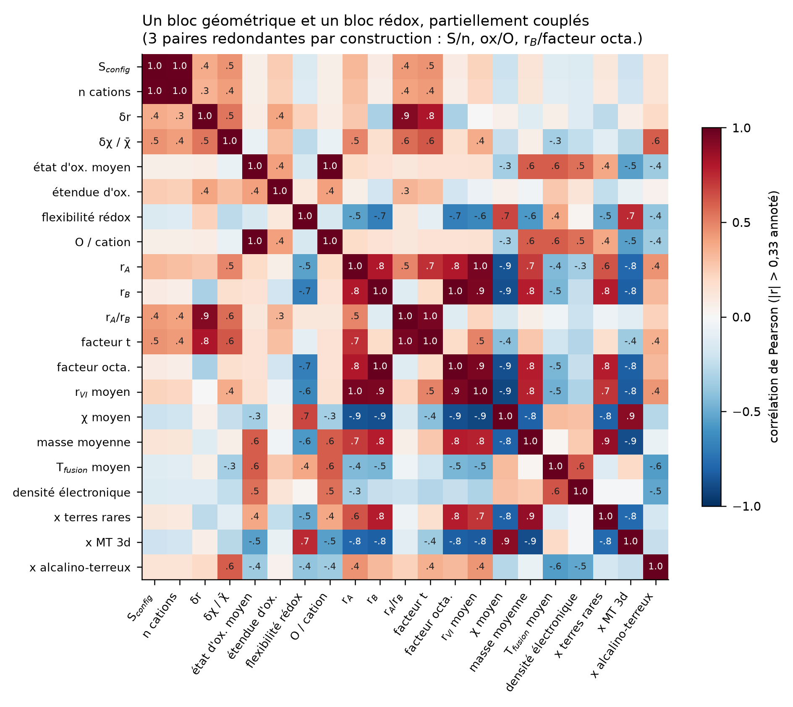
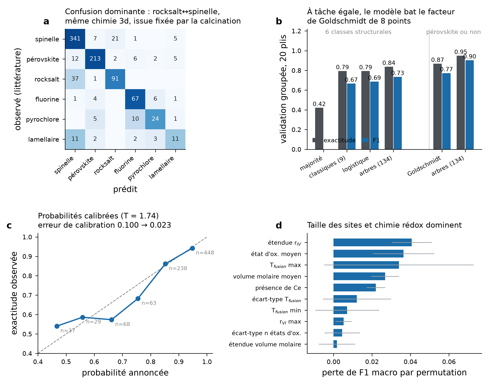
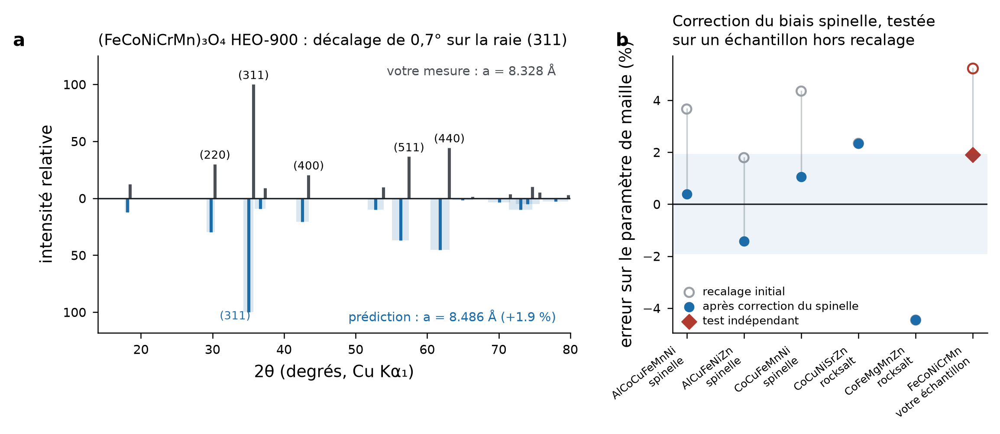
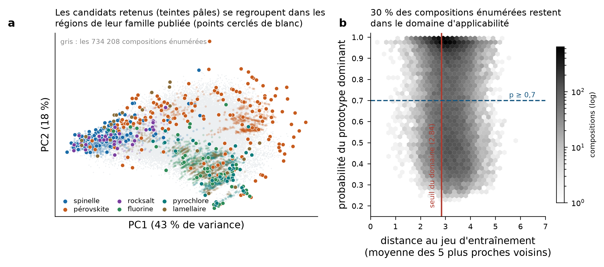

# Plateforme de conception d'oxydes à haute entropie — rapport méthodologique

**Livrable principal** : `heo_designer.html`, un fichier unique de 2,2 Mo, sans
dépendance réseau, à ouvrir par double-clic. Il contient la base de données, le modèle
entraîné, le calcul des descripteurs et la simulation de diffractogramme.

---

## 1. Ce que la plateforme prédit, et ce qu'elle ne prédit pas

| Sortie | Statut | Performance mesurée |
|---|---|---|
| Famille structurale (6 classes) | **opérationnel** | exactitude 83,7 %, F1 macro 0,734 |
| Pérovskite ou non | **opérationnel** | exactitude 94,8 % (Goldschmidt : 86,8 %) |
| Paramètre de maille | **opérationnel, ± 2 %** | écart absolu moyen 1,9 % ; test indépendant +1,9 % |
| Diffractogramme de poudre simulé | **opérationnel** | positions et intensités validées contre `pymatgen` |
| Nouveauté de la combinaison | **opérationnel** | sur 927 publications récoltées |
| Domaine d'applicabilité | **opérationnel** | seuil au 95ᵉ centile des distances d'entraînement |
| Monophasé ou multiphasé | **peu fiable** | 416 positifs contre 54 négatifs — biais de publication |
| Activité électrocatalytique | **non implémenté, délibérément** | voir §6 |
| Activité photocatalytique | **non implémenté, délibérément** | voir §6 |
| Morphologie, surface spécifique, voie de synthèse | **hors de portée** | déterminées par le procédé |

## 2. Corpus et base de données

2189 notices récoltées via EuropePMC (561), Crossref (1527) et arXiv (101), filtrées par
expression exacte sur le titre et le résumé, dédupliquées par DOI.

L'extraction est faite par modèle de langue sous schéma JSON imposé : un appel par
résumé pour les 952 notices disposant d'un résumé complet, par lots de dix titres pour
les 1237 restantes. Chaque échantillon conserve la **phrase source** et son DOI.

Après normalisation des formules, harmonisation du vocabulaire de phase et exigence d'au
moins cinq cations principaux : **1133 échantillons, 926 publications identifiées par DOI,
559 systèmes cationiques distincts, 54 cations** (58 échantillons proviennent de préprints
arXiv sans DOI).

Le panneau **d** est le résultat le plus important de cette étape, et il confirme ce
qu'annonçait la note de faisabilité : la littérature livre massivement la structure
(905 labels, 80 % des échantillons) et presque jamais les grandeurs quantitatives —
94 températures de calcination, 14 surfaces BET, 12 gaps optiques, **5 paramètres de
maille**. Toute l'architecture en découle.

### Audit qualité (n = 10, contre le texte source)

| Champ | Exactitude | Conséquence |
|---|---|---|
| Ensemble de cations | 8/10 | un Ta omis dans une formule à deux sous-réseaux |
| Label de phase | 10/10 | utilisable tel quel |
| Prototype structural | 6/7 renseignés | un « trirutile » classé « autre » |
| **Fractions stœchiométriques** | **7/10** | **écartées de l'apprentissage** |

Deux décisions de curation découlent de cet audit : les descripteurs sont calculés en
**pondération équimolaire** (les fractions extraites restent dans la base mais ne servent
pas à l'apprentissage), et le seuil de **cinq cations minimum** élimine les faux positifs
du type « membre extrême x = 0 d'une série dopée ».

## 3. Descripteurs

134 descripteurs, tous recalculables à partir de la seule composition :

- **85 statistiques élémentaires pondérées** (moyenne, écart-type, min, max, étendue) sur
  17 propriétés : rayons de Shannon en coordinence IV, VI, VIII et XII, électronégativité
  de Pauling, numéro et masse atomiques, état d'oxydation, nombre d'états accessibles,
  groupe, période, rayon atomique, températures de fusion et d'ébullition, volume molaire,
  première énergie d'ionisation, affinité électronique, densité électronique ;
- entropie configurationnelle, désaccord de taille δr, désaccord d'électronégativité ;
- **séparation des sites A et B** par rayon ionique décroissant, d'où le facteur de
  tolérance de Goldschmidt et le facteur octaédrique ;
- six fractions de familles chimiques et la présence des 30 cations les plus fréquents.

Vérifications physiques : t(SrTiO₃) = 1,002 (valeur admise ≈ 1,00) ; rayon cationique
moyen de (MgCoNiCuZn)O = 0,692 Å contre 0,71 Å déduit du paramètre de maille expérimental.

**La température de calcination a été écartée des descripteurs** : renseignée dans 94 cas
sur 1133, elle n'était pas exploitable. C'est une entorse assumée à ce qu'annonçait la
note de faisabilité, et elle a un coût direct, visible au §4.

## 4. Classifieur et validation

Arbres de décision boostés par histogramme (250 itérations, 15 feuilles, pondération des
classes équilibrée). **Validation croisée en 20 plis groupés par système cationique** :
aucun système chimique n'apparaît simultanément en apprentissage et en test, ce qui
interdit au modèle de reconnaître une composition déjà vue. C'est la précaution décisive :
le système Co-Cr-Fe-Mn-Ni apparaît 123 fois dans la base et Mg-Co-Ni-Cu-Zn 95 fois ; un
découpage aléatoire aurait réparti ces entrées des deux côtés et gonflé artificiellement
les scores.

| Modèle | Exactitude | F1 macro | Log-vraisemblance |
|---|---|---|---|
| Arbres boostés, 134 descripteurs | **0,837** | **0,734** | **0,625** |
| Mêmes arbres, 9 descripteurs classiques | 0,794 | 0,666 | 0,784 |
| Régression logistique, 134 descripteurs | 0,793 | 0,686 | 0,686 |
| Classe majoritaire (spinelle) | 0,420 | — | — |

Le gain du jeu complet sur les descripteurs classiques est de **4,4 points d'exactitude et
6,8 points de F1 macro** — réel mais modeste : l'essentiel du signal est déjà dans la
géométrie des sites et la chimie rédox. Sur la tâche binaire pérovskite/non-pérovskite,
comparable à ce que publie la littérature, le modèle atteint **94,8 %** contre **86,8 %**
pour une règle de Goldschmidt dont les bornes ont été optimisées sur la base elle-même
(référence volontairement optimiste).

F1 par classe : pérovskite 0,90, spinelle 0,88, fluorine 0,81, rocksalt 0,75,
pyrochlore 0,64, lamellaire 0,42.

**La confusion dominante est rocksalt ↔ spinelle** (37 + 21 cas). Ce n'est pas un défaut du
modèle mais la trace de l'information manquante : les mêmes cations 3d donnent l'une ou
l'autre structure selon la température de calcination et la stœchiométrie en oxygène,
information absente de 92 % des résumés. Si l'on dispose d'un corpus de textes intégraux,
c'est là que se trouve le gain le plus immédiat.

Probabilités calibrées par mise à l'échelle de température (T = 1,74) ajustée sur les
prédictions hors échantillon : erreur de calibration 0,100 → 0,023. Une annonce à 95 %
correspond à 94 % d'exactitude observée ; une annonce à 66 % à 57 % seulement — l'interface
affiche la probabilité calibrée, pas la brute.

**Domaine d'applicabilité** : distance moyenne aux 5 plus proches voisins dans l'espace
standardisé de 20 descripteurs interprétables, seuil au 95ᵉ centile (2,84). Au-delà,
l'interface refuse d'interpréter la probabilité. Ce n'est pas une prudence cosmétique : une
composition exotique comme Na-K-Te-Ag-Pb se situe à 5,74, soit deux fois le seuil.

## 5. Maille, diffractogramme et confrontation expérimentale

Le régresseur appris prévu au départ est **irréalisable** : 5 paramètres de maille
rapportés sur 1133 échantillons. Il a été remplacé par un modèle géométrique sur rayons de
Shannon, recalé par prototype sur un composé de référence (MgO, CeO₂, SrTiO₃, MgAl₂O₄,
Y₂O₃, Y₂Ti₂O₇). Les listes de réflexions des six prototypes cubiques ont été calculées à
partir des facteurs de structure exacts et **validées contre `pymatgen`** : positions et
intensités identiques sur les six composés de référence.

Aucun fichier de diffraction brut n'était disponible pour ce travail (les données
expérimentales accessibles se limitaient à des courbes de potentiostat LSV/CV/CP/EIS,
de l'UV-vis et un spectre DRS), donc la
superposition prédiction/mesure sur diffractogramme brut n'a pas pu être faite. La
confrontation s'est appuyée sur une valeur rapportée dans un manuscrit en cours de
soumission :
**(FeCoNiCrMn)₃O₄ calciné à 900 °C, spinelle Fd-3m, a = 8,328 Å**.

1. Le classifieur prédit **spinelle** (68 %) — correct.
2. Le modèle géométrique initial donnait 8,763 Å, soit **+5,2 %**.
3. Les trois spinelles HEO de la littérature montraient le même biais (+1,8 %, +3,7 %,
   +4,3 %, moyenne +3,3 %), attribuable à l'hypothèse de distribution cationique
   aléatoire sur le site tétraédrique alors que les spinelles HEO sont partiellement
   inverses.
4. Après correction du biais **calibrée sur ces trois points de littérature seulement**,
   l'erreur sur l'échantillon de test indépendant — qui n'entre pas dans le recalage — tombe à **+1,9 %**,
   en accord avec l'écart absolu moyen de 1,9 % sur les cinq points de littérature.

C'est une validation à un seul point, et elle doit être lue comme telle. Mais elle est
indépendante, et la cohérence entre l'incertitude annoncée et l'erreur observée est le
seul argument sérieux qu'un tel modèle puisse produire à ce stade.

## 6. Pourquoi aucune propriété catalytique n'est prédite

Ce n'est pas un manque de temps, c'est une décision. Sur les 1133 échantillons, un gap
optique est rapporté 12 fois et une surface BET 14 fois. Surtout, les grandeurs
d'électrocatalyse publiées ne sont pas des propriétés du matériau mais de l'**électrode** :
le surpotentiel à 10 mA/cm² dépend de la charge massique, du substrat, du liant, de
l'électrolyte, de la normalisation (surface géométrique ou surface électrochimiquement
active) et de la correction de chute ohmique. Les jeux de données expérimentaux consultés pour ce
travail l'illustrent directement : un même matériau y est caractérisé sur trois électrodes
différentes (mousse de nickel, carbone noir/Nafion, PVDF/NMP), avec un substrat traité à
part. Agréger ces
valeurs entre laboratoires revient à apprendre du bruit de protocole.

La voie praticable est celle qu'emploie la littérature récente : ne pas apprendre le
surpotentiel, mais un **descripteur physique calculable** qui corrèle avec l'activité —
typiquement l'énergie de formation des lacunes d'oxygène, obtenue en DFT ou par potentiel
interatomique appris. C'est le prolongement naturel de ce travail, et il demande du calcul,
pas de la fouille de littérature.

## 7. Criblage

734 208 compositions évaluées : les 658 008 quinaires équimolaires des 40 cations
documentés au moins 20 fois, plus 76 200 sénaires obtenus en ajoutant un cation aux 3000
meilleurs quinaires.

- **219 242** compositions dans le domaine d'applicabilité (30 %) ;
- **218 987** à la fois absentes de la base et dans le domaine ;
- **129 341** à p ≥ 0,7 ;
- 3589 exportées dans l'interface, au maximum 700 par prototype pour éviter que les
  pérovskites n'écrasent la liste.

Meilleur candidat non publié par famille :

| Prototype | Composition | p | a prédit |
|---|---|---|---|
| spinelle | Al-Cr-Mn-Ni-Zn | 0,986 | 8,418 Å |
| pérovskite | Co-Cr-Fe-Ga-Hf-Sr | 0,995 | 3,821 Å |
| rocksalt | Co-Cu-Na-Ni-Zn | 0,914 | 4,276 Å |
| fluorine | Ce-Pr-Sm-Y-Zr | 0,995 | 5,496 Å |
| pyrochlore | Gd-Hf-La-Nd-Yb | 0,990 | 10,512 Å |
| lamellaire | Gd-Sc-Tm-Y-Yb | 0,973 | — |

**Deux mises en garde à lire avant d'allumer un four.** D'abord, 69 % des compositions
énumérées sont prédites pérovskite, parce que l'énumération combinatoire sur un vivier
riche en terres rares et alcalino-terreux produit massivement des compositions à gros
cations ; à l'inverse le modèle ne prédit rocksalt que 130 fois sur 734 208, c'est-à-dire
presque uniquement pour les ensembles 3d déjà connus. Ensuite le haut du classement est
occupé par des variantes quasi identiques (familles Ba-Sr-terre rare-Cr) : la liste se lit
par famille chimique, pas ligne à ligne. Et la probabilité affichée est celle d'une
**famille structurale**, jamais d'une performance.

## 8. Reproductibilité de l'interface

Le modèle embarqué dans la page est l'export exact du modèle `scikit-learn` : 42 272 nœuds
d'arbres, seuils non arrondis. Les descripteurs sont recalculés en JavaScript et la parité
numérique avec `features.py` a été vérifiée sur 200 compositions tirées au hasard —
**écart maximal de probabilité 5,6 × 10⁻¹⁶** (`parity_check.txt`).

Trois bugs de parité ont dû être corrigés, et le dernier mérite d'être noté pour quiconque
reproduira ce portage :

1. seuils de coupure arrondis à sept décimales à l'export — une valeur de descripteur
   tombant exactement sur un seuil basculait du mauvais côté ;
2. un `Math.fround` introduit à tort, sur l'hypothèse fausse que `scikit-learn` traverse
   les arbres en float32 (c'est float64) ;
3. surtout : `sum()` de CPython ≥ 3.12 utilise la **sommation compensée de Neumaier**. Un
   accumulateur naïf en JavaScript s'écarte d'un *ulp*, ce qui suffisait à faire basculer
   **89 arbres sur 1500** et à transformer une prédiction à 80 % en quasi-égalité. Le
   portage réimplémente l'algorithme de CPython.

La leçon générale : un modèle à arbres entraîné sur des descripteurs dont certains ne
prennent que quelques valeurs distinctes place ses seuils *sur* les valeurs des données.
Tout portage doit alors être bit-exact, pas seulement « proche ».

## 9. Comment réentraîner quand de nouvelles manips arrivent

Le point important : **des résultats produits en interne valent plus que dix articles**, parce qu'ils
sont à protocole constant. Y compris les échecs — un lot multiphasé est une étiquette
négative, et la base en manque cruellement.

1. Ajouter des lignes à `heo_database.csv` en respectant les colonnes `cations`, `n_cat`,
   `phase` (`single`/`multi`), `proto`, `a_ang`, `T_C`, `route`, `doi` (mettre une
   référence interne de cahier de laboratoire si non publié).
2. Recalculer les descripteurs avec `features.py` (seule source de vérité du vecteur de
   descripteurs : le JavaScript n'en est qu'un miroir vérifié).
3. Réentraîner avec validation groupée par système cationique — **ne jamais** utiliser de
   découpage aléatoire.
4. Réexporter le modèle avec des seuils non arrondis et **refaire tourner le contrôle de
   parité** avant de rediffuser la page.

## 10. Les trois prolongements qui rapporteraient le plus

1. **Textes intégraux plutôt que résumés.** La température de calcination, le paramètre de
   maille et la surface BET sont dans les sections expérimentales, jamais dans les résumés.
   C'est ce qui débloquerait à la fois la confusion rocksalt ↔ spinelle et un vrai
   régresseur de maille.
2. **Descripteur physique calculé** (énergie de formation des lacunes d'oxygène) par
   potentiel interatomique appris, pour approcher l'activité sans apprendre des
   surpotentiels incomparables.
3. **Boucle d'apprentissage actif** : synthétiser les 3 candidats les plus *informatifs*
   plutôt que les mieux classés, et réinjecter les résultats — y compris négatifs.

---

### Fichiers

| Fichier | Contenu |
|---|---|
| `heo_designer.html` | interface autonome (modèle, base, descripteurs, simulation DRX) |
| `heo_database.csv` | 1133 échantillons curés, avec DOI et phrase source |
| `heo_candidats.csv` | 3589 candidats non publiés, avec voisin publié le plus proche |
| `screening_all.csv.gz` | les 734 208 compositions criblées |
| `heo_features.csv` | matrice des 134 descripteurs |
| `heo_audit.csv` | audit manuel champ par champ |
| `heo_extracted.jsonl` | sortie brute d'extraction, avant curation |
| `heo_corpus.jsonl` | 2189 notices récoltées |
| `features.py` | spécification des descripteurs (source de vérité) |
| `heo_model.json` | export du modèle et jeu de contrôle de parité |
| `element_properties.json` | table élémentaire (58 éléments) |
| `xrd_prototypes.json` | réflexions et facteurs de diffusion des 6 prototypes |
| `lattice_model.json` | constantes du modèle géométrique de maille |
| `parity_check.txt` | résultat du contrôle de parité JavaScript / Python |
